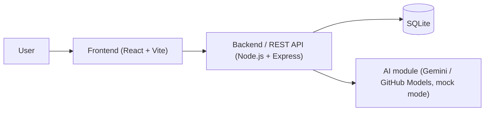
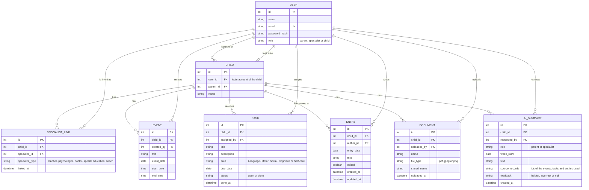

# Software Design Document (SDD)

**Team name:** ChildConnect  
**Version:** ☒ First version (Week 6) ☐ Final (Week 10)  
**Last updated:** 2026-11-01

---

## 1. Architecture Overview

_To be completed by Yiğit (SCRUM-36): 2–3 sentence description of the architecture. The diagram below is the starting point._

### Technology Stack

| Layer | Technology |
|---|---|
| Frontend | React (Vite) |
| Backend | Node.js + Express, JWT authentication |
| Database | SQLite |
| Testing | Jest + Supertest, Vitest, Playwright |
| CI | GitHub Actions |

---

## 2. Module Design

M1, M2 and M7 are added by Sıla (SCRUM-24); M4 and M8 by Yiğit (SCRUM-36).

| Module | Main components | Implements requirements |
|---|---|---|
| M1 | _(Sıla, SCRUM-24)_ | FR-M1-01 … FR-M1-07 |
| M2 | _(Sıla, SCRUM-24)_ | FR-M2-01 … FR-M2-07 |
| M3 | **Frontend:** `WeeklySchedulePage` (weekly view, previous/next week), `EventForm` (title, date, start and end time, validation). **Backend:** `eventsRouter` (`GET /children/:id/events?week=`, `POST /children/:id/events`, `PUT /events/:id`, `DELETE /events/:id`), `eventsService` (Monday–Sunday week range, validation), `requireLinkedAccess` middleware (parent, linked specialist or the child). **Data:** `EVENT` table. | FR-M3-01 … FR-M3-06 |
| M4 | _(Yiğit, SCRUM-36)_ | FR-M4-01 … FR-M4-07 |
| M5 | **Frontend:** `EntryForm` (date, text), `EntryList` (shows the "edited" mark), used on the specialist's child profile and on the parent's dashboard. **Backend:** `entriesRouter` (`GET /children/:id/entries`, `POST /children/:id/entries`, `PUT /entries/:id`), `entriesService` (sets `edited` and `updated_at` on every change; only the author can edit), `denyChild` middleware (child requests get HTTP 403). **Data:** `ENTRY` table. | FR-M5-01 … FR-M5-05 |
| M6 | **Frontend:** `DocumentUpload` (file picker, type and size check), `DocumentList` (name, type, uploader, date, view/download). **Backend:** `documentsRouter` (`POST /children/:id/documents`, `GET /children/:id/documents`, `GET /documents/:id/download`), `upload` middleware (multer: PDF/JPEG/PNG only, 10 MB limit), `denyChild` middleware. Files are stored in `server/uploads/` under generated names and are served only through the download endpoint after the access check. **Data:** `DOCUMENT` table. | FR-M6-01 … FR-M6-05 |
| M7 | _(Sıla, SCRUM-24)_ | FR-M7-01 … FR-M7-05 |
| M8 | _(Yiğit, SCRUM-36)_ | FR-M8-01 … FR-M8-08 |

---

## 3. Data Model

The child is also a user (role `child`), so `CHILD` points to a `USER` row for login. A specialist can read or write data about a child only while a `SPECIALIST_LINK` row exists; deleting that row on "unlink" is what makes every later request fail (FR-M2-05).

---

## 4. API / Interfaces

_To be completed by Yiğit (SCRUM-36). The endpoints of M3, M5 and M6 are named in Section 2._

| Method | Endpoint | Description | Module |
|---|---|---|---|
| GET | | | |
| POST | | | |

---

## 5. Critical Flows

_To be completed by Yiğit (SCRUM-36): one sequence diagram for each of the 3 critical flows of SRS Section 4._

### Flow 1: Specialist assigns a task, child completes it

### Flow 2: Parent unlinks a specialist

### Flow 3: Parent gets the weekly AI summary

---

## 6. User Interface

| Screen | Image | Module |
|---|---|---|
| Login | `docs/img/ui-login.png` | M1 |
| Parent – weekly dashboard | `docs/img/ui-parent-dashboard.png` | M3, M4, M5, M7, M8 |
| Parent – linked specialists | `docs/img/ui-parent-specialists.png` | M2 |
| Parent – documents | `docs/img/ui-parent-documents.png` | M6 |
| Child – my tasks | `docs/img/ui-child-tasks.png` | M3, M4 |
| Specialist – child profile and new entry | `docs/img/ui-specialist-profile.png` | M5, M6, M8 |
| Specialist – assigning and tracking tasks | `docs/img/ui-specialist-tasks.png` | M4 |

---

## 7. Change Log

| Date | Change | By |
|---|---|---|
| 2026-11-01 | First version: SDD file opened, ER diagram, UI screen list, M3/M5/M6 module rows | Nehir |
