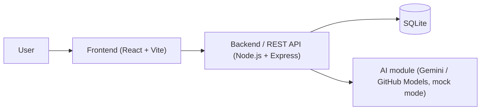
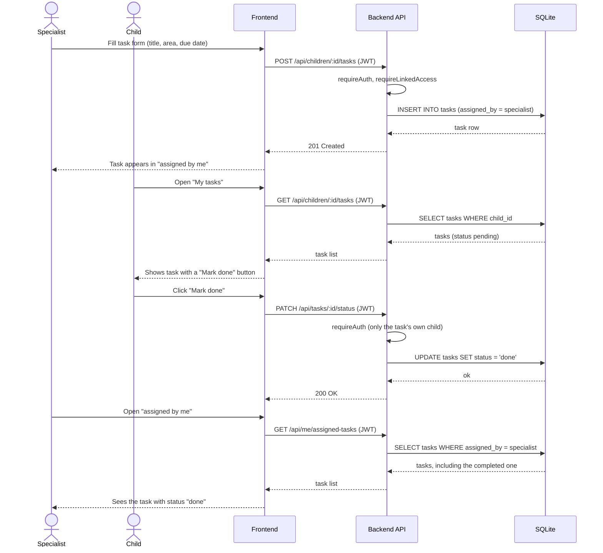
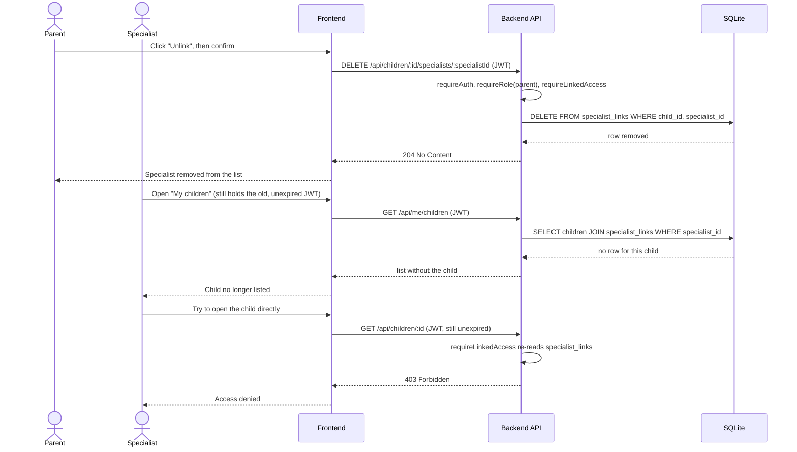

# Software Design Document (SDD)

**Team name:** ChildConnect  
**Version:** ☒ First version (Week 6) ☐ Final (Week 10)  
**Last updated:** 2026-11-10

---

## 1. Architecture Overview

ChildConnect is a single-page React (Vite) client that talks to a Node.js/Express REST API over JSON; the API is the only component that touches the SQLite database and the AI provider, so every access rule (JWT role check, parent/specialist/child link check) is enforced once, in the backend, instead of being duplicated in the UI. Authentication is stateless: the backend signs a JWT at login and every later request carries it in the `Authorization` header, which lets the `requireAuth`, `requireRole` and `requireLinkedAccess` middleware reject a request before it reaches its route handler (NFR-04). The AI component sits behind a single backend module so the rest of the app does not depend on a specific provider, and the test suite and CI run against its mock mode instead of a real API key (C-2, FR-M8-06).



### Technology Stack

| Layer | Technology |
|---|---|
| Frontend | React (Vite) |
| Backend | Node.js + Express, JWT authentication |
| Database | SQLite |
| Testing | Jest + Supertest, Vitest, Playwright |
| CI | GitHub Actions |

---

## 2. Module Design

| Module | Main components | Implements requirements |
|---|---|---|
| M1 | **Frontend:** `LoginPage` (email and password, error message), `AuthContext` (keeps the JWT, logout), `RoleRoute` (sends each role to its own screens: parent dashboard, specialist's children list, child's task screen). **Backend:** `authRouter` (`POST /auth/login`, `GET /auth/me`), `authService` (bcrypt password check, signs a JWT with an expiry time), `requireAuth` middleware (invalid or missing token → HTTP 401), `requireRole` middleware (wrong role → HTTP 403). **Data:** `USER` table. | FR-M1-01 … FR-M1-07 |
| M2 | **Frontend:** `LinkedSpecialistsPage` (list of linked specialists, link form with email and specialist type, unlink with confirmation, error for an unregistered email), `MyChildrenPage` (specialist's list of linked children). **Backend:** `linksRouter` (`GET /children/:id/specialists`, `POST /children/:id/specialists`, `DELETE /children/:id/specialists/:specialistId`, `GET /me/children`), `linksService` (checks that the email belongs to a registered specialist, prevents duplicate links), `requireLinkedAccess` middleware (shared by M3–M8: reads the current `SPECIALIST_LINK` row on every request, so an unlinked specialist gets HTTP 403 even with a valid JWT). **Data:** `SPECIALIST_LINK` table. | FR-M2-01 … FR-M2-07 |
| M3 | **Frontend:** `WeeklySchedulePage` (weekly view, previous/next week), `EventForm` (title, date, start and end time, validation). **Backend:** `eventsRouter` (`GET /children/:id/events?week=`, `POST /children/:id/events`, `PUT /events/:id`, `DELETE /events/:id`), `eventsService` (Monday–Sunday week range, validation), `requireLinkedAccess` middleware (parent, linked specialist or the child). **Data:** `EVENT` table. | FR-M3-01 … FR-M3-06 |
| M4 | **Frontend:** `TaskForm` (title, description, development area select restricted to the fixed list, due date; shown to the parent and linked specialists), `TaskList` (reused for two views — the child's own tasks with a "Mark done" button, and an assigner's view of the tasks they assigned with each task's status), used on the parent dashboard, the specialist's child profile and the child's task screen. **Backend:** `tasksRouter` (`GET /children/:id/tasks`, `POST /children/:id/tasks`, `PATCH /tasks/:id/status`, `GET /me/assigned-tasks`), `tasksService` (rejects a task without a title, area or due date; validates the area against the fixed list; only the child who owns a task can mark it done), `requireLinkedAccess` middleware (parent, linked specialist or the child). **Data:** `TASK` table. | FR-M4-01 … FR-M4-07 |
| M5 | **Frontend:** `EntryForm` (date, text), `EntryList` (shows the "edited" mark), used on the specialist's child profile and on the parent's dashboard. **Backend:** `entriesRouter` (`GET /children/:id/entries`, `POST /children/:id/entries`, `PUT /entries/:id`), `entriesService` (sets `edited` and `updated_at` on every change; only the author can edit), `denyChild` middleware (child requests get HTTP 403). **Data:** `ENTRY` table. | FR-M5-01 … FR-M5-05 |
| M6 | **Frontend:** `DocumentUpload` (file picker, type and size check), `DocumentList` (name, type, uploader, date, view/download). **Backend:** `documentsRouter` (`POST /children/:id/documents`, `GET /children/:id/documents`, `GET /documents/:id/download`), `upload` middleware (multer: PDF/JPEG/PNG only, 10 MB limit), `denyChild` middleware. Files are stored in `server/uploads/` under generated names and are served only through the download endpoint after the access check. **Data:** `DOCUMENT` table. | FR-M6-01 … FR-M6-05 |
| M7 | **Frontend:** `WeeklyStatsCard` (week picker, total completion rate, rate per development area, "No tasks this week"), shown on the parent dashboard and the specialist's child profile. **Backend:** `statsRouter` (`GET /children/:id/stats?week=`), `statsService` (pure function: completed tasks ÷ tasks due in the week, in total and per area; unit tested), `requireLinkedAccess` and `denyChild` middleware. **Data:** reads the `TASK` table; no new table. | FR-M7-01 … FR-M7-05 |
| M8 | **Frontend:** `AiSummaryCard` (week picker, "Get AI summary" button, the summary labelled "AI-generated" with a link to each source record it cites, an error state that leaves the rest of the page working). **Backend:** `aiRouter` (`POST /children/:id/ai-summary?week=`), `aiService` — the single module every AI call goes through: it reads only the events, tasks and entries the requesting user is allowed to see, builds a separate prompt for a parent request and for a specialist request, and every prompt instructs the model not to diagnose, decide or suggest treatment and to answer as a suggestion only; the module exposes a mock mode (used in tests and CI, C-2) so no real API key is needed to run the suite, and a real-provider call failure is caught and turned into an error response instead of crashing the request. **Data:** `AI_SUMMARY` table (stores the requester, role, week, summary text and the ids of the source records, which is what the frontend renders as the source links in FR-M8-04). | FR-M8-01 … FR-M8-08 |

---

## 3. Data Model

The child is also a user (role `child`), so `CHILD` points to a `USER` row for login. A specialist can read or write data about a child only while a `SPECIALIST_LINK` row exists; deleting that row on "unlink" is what makes every later request fail (FR-M2-05).


---

## 4. API / Interfaces

| Method | Endpoint | Description | Module |
|---|---|---|---|
| POST | `/api/auth/login` | Log in with email and password; returns a JWT and the user | M1 |
| GET | `/api/auth/me` | The logged-in user, from the token | M1 |
| GET | `/api/specialist-types` | The fixed list of specialist types | M2 |
| GET | `/api/me/children` | Parent: own children. Specialist: linked children | M2 |
| GET | `/api/children/:id` | Basic child info; every child-scoped request is access-checked here first | M2 |
| GET | `/api/children/:id/specialists` | List the specialists linked to the child | M2 |
| POST | `/api/children/:id/specialists` | Link a registered specialist to the child | M2 |
| DELETE | `/api/children/:id/specialists/:specialistId` | Unlink a specialist | M2 |
| GET | `/api/children/:id/events?week=` | The child's events for a Monday–Sunday week | M3 |
| POST | `/api/children/:id/events` | Add an event | M3 |
| PUT | `/api/events/:id` | Edit an event | M3 |
| DELETE | `/api/events/:id` | Delete an event | M3 |
| GET | `/api/children/:id/tasks` | The child's tasks (parent and child see all of them; see also `/me/assigned-tasks`) | M4 |
| POST | `/api/children/:id/tasks` | Assign a task to the child | M4 |
| PATCH | `/api/tasks/:id/status` | Mark a task done; only the owning child may call this | M4 |
| GET | `/api/me/assigned-tasks` | The tasks the logged-in parent/specialist assigned, with status | M4 |
| GET | `/api/children/:id/entries` | The child's observations, in date order | M5 |
| POST | `/api/children/:id/entries` | Add an observation | M5 |
| PUT | `/api/entries/:id` | Edit an observation; only its author may call this | M5 |
| POST | `/api/children/:id/documents` | Upload a PDF/JPG/PNG document (max 10 MB) | M6 |
| GET | `/api/children/:id/documents` | List the child's documents | M6 |
| GET | `/api/documents/:id/download` | Download one document | M6 |
| GET | `/api/children/:id/stats?week=` | Task completion rate for the week, total and per development area | M7 |
| POST | `/api/children/:id/ai-summary?week=` | Request the AI-generated weekly summary | M8 |

All endpoints except `/api/auth/login` require `Authorization: Bearer <token>` (FR-M1-06); every `/children/:id/...` endpoint additionally goes through `requireLinkedAccess` (FR-M2-06).

---

## 5. Critical Flows

### Flow 1: Specialist assigns a task, child completes it

FR-M4-01, FR-M4-05, FR-M4-06, FR-M2-06



### Flow 2: Parent unlinks a specialist

FR-M2-04, FR-M2-05, FR-M2-06



### Flow 3: Parent gets the weekly AI summary

FR-M8-01, FR-M8-03, FR-M8-04, FR-M8-06

```mermaid
sequenceDiagram
    actor P as Parent
    participant FE as Frontend
    participant API as Backend API
    participant DB as SQLite
    participant AI as AI module (mock/real)

    P->>FE: Pick a week, click "Get AI summary"
    FE->>API: POST /api/children/:id/ai-summary?week= (JWT)
    API->>API: requireAuth, requireLinkedAccess
    API->>DB: SELECT events, tasks, entries for child + week
    DB-->>API: records the parent is allowed to see
    API->>API: Build the parent prompt (role = parent)
    API->>AI: Send prompt + records (mock mode in tests/CI)
    AI-->>API: summary text
    API->>DB: INSERT INTO ai_summary (text, source_records, role)
    API-->>FE: 200 { summary, sourceRecordIds, label: "AI-generated" }
    FE-->>P: Shows the "AI-generated" summary with links to its source records

    alt AI service fails
        API->>AI: Send prompt
        AI--xAPI: error or timeout
        API-->>FE: 502 { error }
        FE-->>P: Error message; the rest of the app keeps working
    end
```

---

## 6. User Interface

| Screen | Image | Module |
|---|---|---|
| Login | `docs/img/ui-login.png` | M1 |
| Parent – weekly dashboard | `docs/img/ui-parent-dashboard.png` | M3, M4, M5, M7, M8 |
| Parent – linked specialists | `docs/img/ui-parent-specialists.png` | M2 |
| Parent – documents | `docs/img/ui-parent-documents.png` | M6 |
| Child – my tasks | `docs/img/ui-child-tasks.png` | M3, M4 |
| Specialist – child profile and new entry | `docs/img/ui-specialist-profile.png` | M5, M6, M8 |
| Specialist – assigning and tracking tasks | `docs/img/ui-specialist-tasks.png` | M4 |

---

## 7. Change Log

| Date | Change | By |
|---|---|---|
| 2026-11-01 | First version: SDD file opened, ER diagram, UI screen list, M3/M5/M6 module rows | Nehir |
| 2026-11-03 | M1/M2/M7 module rows | Sıla |
| 2026-11-10 | Architecture overview (Section 1); M4 and M8 module rows (Section 2); full API table for M1–M8 (Section 4); sequence diagrams for the 3 critical flows (Section 5) | Yiğit |
